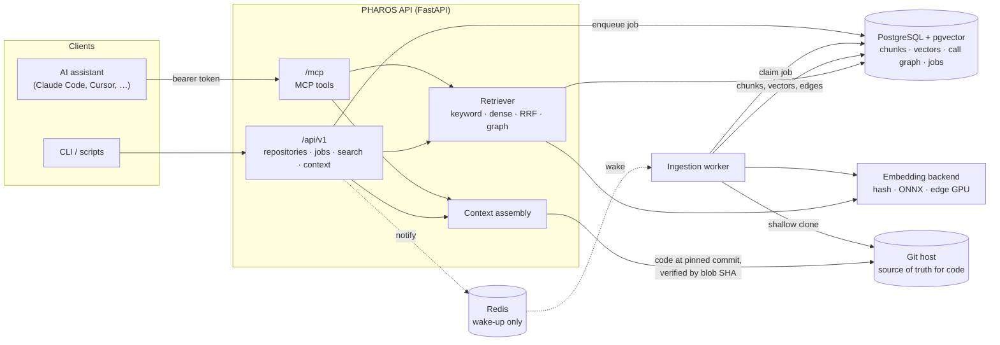

# PHAROS — A Code-Intelligence Backend for AI Coding Assistants

[](https://github.com/ram-tewari/PHAROS/actions/workflows/ci.yml)


PHAROS indexes git repositories into PostgreSQL and serves them to AI coding assistants:
- **Repository-scoped search:** keyword, dense, hybrid and call-graph modes.
- **Symbol lookup with callers and callees.**
- **A `retrieve_context` call** that returns the most relevant functions with their source.

Source is read from git at the indexed commit and checked against the blob SHA before it is
returned. Everything is available over a REST API and a native
[MCP](https://modelcontextprotocol.io) endpoint.

**Measured results.** The quality numbers below come from locked test sets, each run once after tuning:

- **Retrieval:** nDCG@10 rose from 0.394 to 0.697 and from 0.463 to 0.726 on two held-out sets
  covering seven repositories in seven languages, on CPU only. Search takes p95 305 ms on a free
  hosting tier. See [Retrieval quality](#retrieval-quality).
- **Repository memory:** correct answers to repository questions rose from 5 to 14 of 30
  (McNemar p = 0.012). The same evaluation **failed its primary measure and its precision target**,
  and the [report](docs/benchmarks/phase2-memory-2026-11-01.md) says so. A
  [second protocol](docs/benchmarks/phase2-eval-protocol-v2.md) was locked afterwards on new data.

> **Status:** beta, single maintainer. The core path is tested end to end on SQLite and PostgreSQL,
> covering clone → AST → embed → index → retrieve → context. Retrieval quality is measured on a
> small hand-labelled benchmark ([results](docs/benchmarks/retrieval-2026-10.md)). Read
> [Limitations](#limitations) before relying on it.

## What it does

| | |
|---|---|
| **Indexing** | Shallow-clones an https repository (GitHub, GitLab or Bitbucket, allowlisted), or a local checkout through the CLI. It walks the committed tree only, skipping vendored, minified, binary and oversized files and symlinks. Each function, method, class and module becomes a chunk. Re-indexing is incremental by blob SHA. |
| **AST parsing** | Python (stdlib `ast`), plus JavaScript, TypeScript/TSX, Go, Rust, C, C++ and Java (tree-sitter). Other files fall back to line windows, and the fallback is recorded per chunk and per language, never presented as AST output. Repository code is parsed, never executed. |
| **Embeddings** | Pluggable: `hash` (offline, lexical, not semantic), `onnx` (CPU; pinned models in `scripts/fetch_onnx_model.py`, default in production granite-embedding-english-r2 int8), `http` (the edge worker's GPU model server) or `sentence-transformers`. Each chunk is embedded from its signature, doc comment, the first 25 lines of its body and its calls. Vectors from different models are never compared. |
| **Retrieval** | `keyword` uses PostgreSQL full-text search over identifiers, paths, signatures and docstrings. `dense` uses pgvector HNSW. `hybrid` is reciprocal-rank fusion plus an exact-symbol boost. `graph` is hybrid plus call-graph neighbours. The default `auto` is `dense`, or `hybrid` when the caller passes `hints` (identifiers it guesses). Tests, docs and examples are down-ranked unless the query asks for them. When a mode cannot run it is reported as unavailable (HTTP 503), not silently degraded. |
| **Context** | The top chunks with verified source, their resolved callers and callees, the repository's learned memory and its coding rules, rendered as Markdown with `path:line` citations inside a character budget. |
| **Memory** (Phase 2) | Learned per indexed commit, on the owner's machine, from the index and the full git history. Deterministic miners produce most of it. An optional Codex pass adds rules from documentation and maintainers' reviews, and those stay proposals until accepted. The server never calls an LLM. It covers conventions (naming, docs, typing, errors, deprecation, tests, changelog, commit style, tooling), which files change together, history (dropped dependencies, runtime versions, moves, file origins) and "add a new X" playbooks. A brief of at most 2,200 characters leads `retrieve_context`. Every item cites evidence that can be re-checked; items are never deleted, only marked stale. **Evaluated once** ([results](docs/benchmarks/phase2-memory-2026-11-01.md)): it does not pass. It makes repository Q&A much better (5 → 14 of 30 correct) and file choices more complete, but not source-file recall, and 55% of audited items are fully supported by their cited evidence. |
| **Jobs** | Durable ingestion jobs in PostgreSQL: atomic claims, retries with backoff, recovery of stalled workers, cancellation, and a queue cap (HTTP 429). Redis only wakes workers up; they also poll. |
| **Interfaces** | REST under `/api/v1`, MCP at `/mcp/`, and the CLI `python -m app.cli`. Auth is static machine-to-machine bearer tokens with two scopes (admin, read). |

## Architecture



```mermaid
flowchart LR
  clone["clone @ commit<br/>(https, allowlisted host)"] --> tree["ls-tree<br/>skip vendored / binary /<br/>minified / large / symlinks"]
  tree --> diff["diff by blob SHA<br/>(unchanged files kept)"]
  diff --> parse["parse<br/>ast · tree-sitter · line fallback"]
  parse --> chunks["one chunk per symbol:<br/>span, signature, docstring,<br/>calls, imports"]
  chunks --> embed["embed semantic summary"]
  chunks --> graph["resolve calls / imports<br/>(ambiguous names left unlinked)"]
  embed & graph --> write["write chunks, vectors, edges<br/>(no source stored)"]
```

## Quick start

You need Python 3.11+, git and Docker (for PostgreSQL with pgvector and Redis).

```bash
git clone https://github.com/ram-tewari/PHAROS && cd PHAROS
python -m venv .venv && . .venv/bin/activate
make install                 # pip install --require-hashes -r backend/requirements-dev.txt
make demo                    # no database needed: indexes a polyglot fixture into a temp SQLite DB
```

`make demo` runs the real CLI end to end; trimmed output:

```
[ok  ] schema: at head (0002_codeintel)
[ok  ] tree-sitter grammar go: ok        (… c, cpp, rust, javascript, typescript, tsx, java)
AST-parsed files per language: {'java': 1, 'c': 2, 'cpp': 1, 'rust': 1, 'python': 6, 'go': 1,
                                'javascript': 2, 'typescript': 2} | line-fallback files: 0
$ python -m app.cli search verify a user's password -k 3
mode=graph (33.7 ms)
 1. 0.0325  shop/auth.py:27-32  shop.auth.authenticate          [function, python-ast]  kw=2 dense=1
 2. 0.0325  shop/auth.py:20-24  shop.auth.verify_password       [function, python-ast]  kw=1 dense=2
 3. 0.0313  shop/auth.py:47-57  shop.auth.TokenSigner.verify    [method, python-ast]    kw=3 dense=5
context: 3 chunks, 1160 chars; top: shop.api.login_handler (shop/api.py:12) code_verified=True
OK.
```

### Run the service

```bash
make db-up                                   # pgvector/pgvector + redis via docker compose
cp backend/config/.env.example backend/config/.env
python -m app.cli gen-token                  # run in backend/; paste into PHAROS_ADMIN_TOKEN, run again for PHAROS_READ_TOKEN
make migrate                                 # alembic -c config/alembic.ini upgrade head
make serve                                   # API on :8000      (or: docker compose up --build)
make worker                                  # in another shell: runs ingestion jobs
```

Index a repository and query it. This is real output against `pallets/click` 8.1.7 with
`EMBEDDING_BACKEND=onnx` (all-MiniLM-L6-v2):

```bash
curl -s -X POST localhost:8000/api/v1/repositories -H "Authorization: Bearer $PHAROS_ADMIN_TOKEN" \
  -H 'Content-Type: application/json' -d '{"repository": "https://github.com/pallets/click", "branch": "8.1.7"}'
# → {"created": true, "notified": true, "job": {"status": "queued", ...}}
# worker log: job succeeded: https://github.com/pallets/click @ 874ca2bc1c30 (71 files indexed, 1043 chunks)

curl -s -X POST localhost:8000/api/v1/search/code -H "Authorization: Bearer $PHAROS_READ_TOKEN" \
  -H 'Content-Type: application/json' \
  -d '{"query": "prompt the user to confirm before continuing", "repository": "pallets/click", "k": 3}'
# 1. click.termui.confirm               src/click/termui.py:190-248
# 2. click.core.Option.prompt_for_value src/click/core.py:2870-2894
# 3. click.termui.prompt                src/click/termui.py:79-187
```

### Connect an AI assistant (MCP)

```bash
claude mcp add --transport http pharos http://localhost:8000/mcp/ \
  --header "Authorization: Bearer $PHAROS_READ_TOKEN"
```

| Tool | Returns |
|---|---|
| `retrieve_context` | Ranked chunks with verified source, callers/callees and rules, plus a Markdown rendering with citations |
| `search_code` | Chunk pointers (path, lines, symbol) with retrieval evidence (keyword/dense rank, graph hops) |
| `find_symbol` | Definitions of a (qualified) name with resolved callers and callees |
| `list_repositories` | Indexed repositories with commit, language coverage and status |
| `get_repo_brief` | The repository brief: layout, main modules, strongest conventions and playbooks |
| `search_memory` | Learned conventions, co-changes and history facts, each with its evidence |
| `list_skills` / `get_skill` | Playbooks for recurring changes. Level 1 has the steps; level 2 adds every file with its rate and example commits |

`retrieve_context` and `search_code` take optional `hints`: identifiers or keywords the assistant guesses
(e.g. `["parse_url", "redirect"]`). They add keyword evidence; the question itself is what gets embedded.

For a deployed server, add its hostname to `MCP_ALLOWED_HOSTS` (DNS-rebinding protection).

## REST API

| Method and path | Scope | Purpose |
|---|---|---|
| `POST /api/v1/repositories` | admin | Queue indexing for `{"repository", "branch"?, "force"?}`. Deduplicates against active jobs; 429 when the queue is full. |
| `GET /api/v1/repositories`, `GET /api/v1/repositories/{id}` | read | Index status, commit, per-language AST/fallback counts, graph stats |
| `DELETE /api/v1/repositories/{id}` | admin | Remove a repository and its chunks, vectors and edges |
| `GET /api/v1/ingestion/jobs`, `GET …/{id}`, `POST …/{id}/cancel` | read / admin | Job state machine: queued → running → succeeded, failed or cancelled |
| `POST /api/v1/search/code` | read | `{"query", "repository"?, "mode"?, "k"?, "languages"?, "kinds"?, "path_prefix"?, "hints"?}` |
| `POST /api/v1/search/symbol` | read | `{"name", "repository"?}`: definitions plus call graph |
| `POST /api/v1/context/retrieve` | read | `{"query", "repository"?, "max_chunks"?, "max_chars"?, "include_code"?, "profile_id"?, "hints"?}` |
| `GET /api/v1/memory/brief?repository=`, `GET /api/v1/memory/items`, `POST /api/v1/memory/search`, `GET /api/v1/memory/skills[/{name}]` | read | Repository memory |
| `PATCH /api/v1/memory/items/{id}?action=accept\|reject\|archive\|restore` | admin | A human decision on a memory item. Learning never overrides it. |
| `POST /api/v1/repositories/{id}/learn`, `GET /api/v1/learning/jobs` | admin / read | Queue learning, which the Mac's learning worker runs |
| `GET /api/v1/system/status` | read | Embedding backend, available modes, repositories |
| `GET /health` | public | Liveness |

OpenAPI is served at `/docs`. Older routers (papers and PDFs, the legacy resource graph, planning,
patterns, monitoring) are still mounted. They are maintained to a lower bar; see
[Limitations](#limitations).

## Retrieval quality

Measured on two locked test sets: 101 hand-labelled questions over seven repositories in seven
languages (click, ky, anyhow, curl, chi, gson, immer), pinned commits, CPU only. The full method,
the development runs and the failures are in the
[phase 1 report](docs/benchmarks/retrieval-phase1-2026-10-30.md).

| | heldout_v1 nDCG@10 | heldout_v2 nDCG@10 | Zero recall@10 |
|---|---|---|---|
| Before (MiniLM, `auto` = hybrid + graph) | 0.394 | 0.463 | 29 of 101 |
| **Now** (granite-embedding-english-r2, `auto` = dense) | **0.697** | **0.726** | 6 of 101 |
| Now, with the assistant's `hints` | 0.709 | 0.822 | 5 of 101 |

- Paired gains: +0.30 [+0.21, +0.40] and +0.26 [+0.18, +0.35]. Every repository improved.
- Production (Render free + Neon free) scores 0.690 on heldout_v1, against 0.697 locally. Search
  takes p50 205 ms and p95 305 ms on the server.
- Tests, docs and examples fell from 16–20% of the top five results to under 3%.
- Questions that name the API scored slightly lower without hints (0.99 → 0.91 on v1), because
  hybrid used to win those. Hints restore them.
- The earlier [October benchmark](docs/benchmarks/retrieval-2026-10.md) and
  [system evaluation](docs/benchmarks/evaluation-2026-10-29.md) explain how the old defaults
  were found wanting.

**Storage:** pointing at code instead of storing it saves about 5% of the database, not the "17×"
claimed in older docs. Vectors and the HNSW index dominate, and the index is about 18× the size of
the source it covers ([details](docs/benchmarks/retrieval-2026-10.md#storage)).

## Configuration

Every setting is documented in [`backend/config/.env.example`](backend/config/.env.example). The ones that matter most:

| Variable | Default | |
|---|---|---|
| `DATABASE_URL` | SQLite file | PostgreSQL + pgvector for real use; `sslmode=require` is honoured |
| `PHAROS_ADMIN_TOKEN`, `PHAROS_READ_TOKEN` | unset | With neither set, every protected endpoint returns 401 |
| `EMBEDDING_BACKEND` | `auto` | `hash`, `onnx`, `http`, `sentence-transformers`, `none` |
| `CODEINTEL_ALLOWED_GIT_HOSTS` | github.com, gitlab.com, bitbucket.org | Only https URLs on these hosts can be indexed |
| `MAX_QUEUE_SIZE` | 10 | Queued jobs before submissions get 429 |
| `MCP_ALLOWED_HOSTS` | `[]` | Public hostnames for `/mcp` |

## Security

- **Authentication** uses static bearer tokens, compared in constant time, and fails closed.
  `TEST_AUTH_BYPASS`, `TESTING` and `TEST_MODE` are refused in production. The read token cannot
  index, delete or invoke admin tools.
- **Repository URLs** must be https on an allowlisted host. The validator rejects IP literals,
  credentials, ports, queries, path traversal, control characters and non-https transports such
  as `ext::` or `file://`. Clone tokens go into a host-scoped header, never into URLs or logs.
- **Repository code is parsed, never executed or imported.** A test indexes hostile `setup.py`,
  `conftest.py` and `Makefile` files and asserts that nothing runs. Code fetched for context is
  verified against the indexed blob SHA.
- **Credential rotation:** credentials were committed to this repository's history before
  2026-10. Rotating them is required; see
  [docs/security/credential-exposure-2026-10.md](docs/security/credential-exposure-2026-10.md).
  To report a vulnerability, see [SECURITY.md](SECURITY.md).

## Limitations

- **Embeddings:** quality numbers come from 101 test questions written by a single annotator who
  also builds the system. Granite needs about 700 MB to embed documents, so on a 512 MB host it can
  only embed queries; indexing then runs on a bigger machine (`backend/deployment/mac/`).
- **Call graph:** resolution is conservative. Calls to names defined more than once, such as
  `self.invoke()` in click's `core.py`, are left unlinked, and dynamic dispatch is not followed.
  Resolution covers 35–56% of call sites on the benchmark repositories; most of the rest go to
  the standard library or dependencies.
- **Scale:** measured up to about 13,000 chunks in one database (six repositories). On pgvector ≥ 0.8,
  repository-filtered dense queries use iterative HNSW scans so they keep returning full candidate
  sets as the database grows; older pgvector filters after the search and can return fewer.
- **Performance:** keyword ranking recomputes `to_tsvector` for every matched row. Indexing
  writes rows one at a time, at about 140 chunks/s plus embedding time.
- **GPU / edge worker:** the CUDA image and the edge worker's GPU path are **not validated** in CI.
- **Repository memory** did not pass its first locked evaluation: 55% of audited items were fully
  supported by their evidence (target 90%), and source-file recall did not improve. The
  [report](docs/benchmarks/phase2-memory-2026-11-01.md) has the numbers. Evidence that proves counted
  claims was added afterwards, and [protocol v2](docs/benchmarks/phase2-eval-protocol-v2.md) tests it
  on new repositories.
  - It is learned only on a machine with full git mirrors (`pharos learn`, or the learning worker).
  - The older `POST /api/patterns/learn` profiles are Python-only, partly wrong, and marked deprecated.
- **Legacy modules** (papers/PDFs, resource graph, planning, monitoring) predate the code index.
  Notably:
  - document-graph entity extraction has no offline extractor and reports `unavailable`;
  - parent-child search is PostgreSQL-only;
  - "AI planning" returns a fixed template plan;
  - URL resource ingestion still calls services that were removed earlier and logs errors for those steps.
- **Database migrations:** the migrations were squashed in 2026-10. An existing database needs the
  one-time procedure in [docs/operations/database-migrations.md](docs/operations/database-migrations.md).

## Development

```bash
make test        # full suite on SQLite (~4 min)
make test-pg     # plus PostgreSQL/pgvector parametrisations (needs `make db-up`)
make lint        # ruff: bug-class rules everywhere, full rules on new code
make isolation   # module-boundary check
make bench       # retrieval benchmark (needs a database named *bench*)
```

CI runs lint, the secret scan, the module-isolation check, the full suite on Python 3.11 and 3.13
against PostgreSQL + pgvector and Redis service containers, migration checks, the demo, a
dependency audit and a Docker build. See [CONTRIBUTING.md](CONTRIBUTING.md).

```
backend/
  app/codeintel/      indexing, parsers, embeddings, retrieval, context, jobs (the core)
  app/modules/code/   /api/v1 code-intelligence endpoints
  app/modules/mcp/    native MCP server (/mcp/) and the legacy REST tool router
  app/modules/…       legacy modules (resources, search, graph, planning, patterns, …)
  app/learning/       repository memory: miners, history, brief, recall (Phase 2)
  app/workers/        ingest_worker (CPU), learning_worker (Mac), main_worker (edge/GPU)
  alembic/            migrations (squashed 2026-10; history in alembic/archive)
  benchmarks/         retrieval benchmark harness, dataset and results
  tests/codeintel/    tests for the core, parametrised over SQLite and PostgreSQL
```

`frontend/` and `pharos-cli/` are earlier prototypes from before the code index. They are kept for
history, are not covered by CI and are not maintained alongside the backend.

## License

MIT, see [LICENSE](LICENSE).
