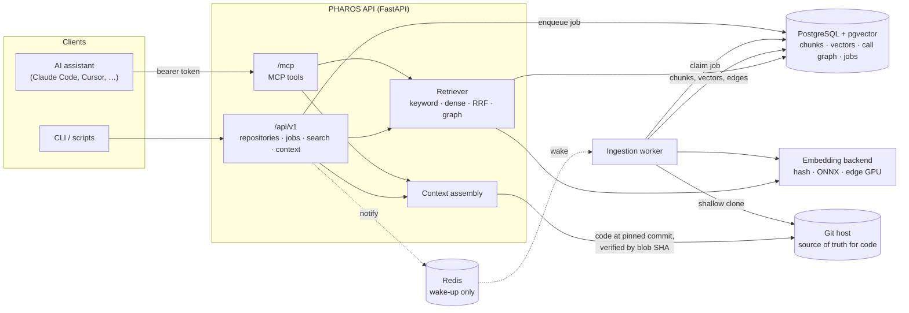

# PHAROS — A Code-Intelligence Backend for AI Coding Assistants

[](https://github.com/ram-tewari/PHAROS/actions/workflows/ci.yml)


PHAROS indexes git repositories into PostgreSQL and serves them to AI coding assistants:
- **Repository-scoped search:** keyword, dense, hybrid and call-graph modes.
- **Symbol lookup with callers and callees.**
- **A `retrieve_context` call** that returns the most relevant functions with their source.

Source is read from git at the indexed commit and checked against the blob SHA before it is
returned. Everything is available over a REST API and a native
[MCP](https://modelcontextprotocol.io) endpoint.

> **Status:** beta, single maintainer. The core path is tested end to end on SQLite and PostgreSQL,
> covering clone → AST → embed → index → retrieve → context. Retrieval quality is measured on a
> small hand-labelled benchmark ([results](docs/benchmarks/retrieval-2026-10.md)). Read
> [Limitations](#limitations) before relying on it.

## What it does

| | |
|---|---|
| **Indexing** | Shallow-clones an https repository (GitHub, GitLab or Bitbucket, allowlisted), or a local checkout through the CLI. It walks the committed tree only, skipping vendored, minified, binary and oversized files and symlinks. Each function, method, class and module becomes a chunk. Re-indexing is incremental by blob SHA. |
| **AST parsing** | Python (stdlib `ast`), plus JavaScript, TypeScript/TSX, Go, Rust, C, C++ and Java (tree-sitter). Other files fall back to line windows, and the fallback is recorded per chunk and per language, never presented as AST output. Repository code is parsed, never executed. |
| **Embeddings** | Pluggable: `hash` (offline, lexical, not semantic), `onnx` (CPU, e.g. all-MiniLM-L6-v2), `http` (the edge worker's GPU model server) or `sentence-transformers`. Vectors from different models are never compared. |
| **Retrieval** | `keyword` uses PostgreSQL full-text search over identifiers, paths, signatures and docstrings. `dense` uses pgvector HNSW. `hybrid` is reciprocal-rank fusion plus an exact-symbol boost. `graph` is hybrid plus call-graph neighbours. When a mode cannot run it is reported as unavailable (HTTP 503), not silently degraded. |
| **Context** | The top chunks with verified source, their resolved callers and callees, and the repository's coding rules, rendered as Markdown with `path:line` citations inside a character budget. |
| **Jobs** | Durable ingestion jobs in PostgreSQL: atomic claims, retries with backoff, recovery of stalled workers, cancellation, and a queue cap (HTTP 429). Redis only wakes workers up; they also poll. |
| **Interfaces** | REST under `/api/v1`, MCP at `/mcp`, and the CLI `python -m app.cli`. Auth is static machine-to-machine bearer tokens with two scopes (admin, read). |

## Architecture



```mermaid
flowchart LR
  clone["clone @ commit<br/>(https, allowlisted host)"] --> tree["ls-tree<br/>skip vendored / binary /<br/>minified / large / symlinks"]
  tree --> diff["diff by blob SHA<br/>(unchanged files kept)"]
  diff --> parse["parse<br/>ast · tree-sitter · line fallback"]
  parse --> chunks["one chunk per symbol:<br/>span, signature, docstring,<br/>calls, imports"]
  chunks --> embed["embed semantic summary"]
  chunks --> graph["resolve calls / imports<br/>(ambiguous names left unlinked)"]
  embed & graph --> write["write chunks, vectors, edges<br/>(no source stored)"]
```

## Quick start

You need Python 3.11+, git and Docker (for PostgreSQL with pgvector and Redis).

```bash
git clone https://github.com/ram-tewari/PHAROS && cd PHAROS
python -m venv .venv && . .venv/bin/activate
make install                 # pip install --require-hashes -r backend/requirements-dev.txt
make demo                    # no database needed: indexes a polyglot fixture into a temp SQLite DB
```

`make demo` runs the real CLI end to end; trimmed output:

```
[ok  ] schema: at head (0002_codeintel)
[ok  ] tree-sitter grammar go: ok        (… c, cpp, rust, javascript, typescript, tsx, java)
AST-parsed files per language: {'java': 1, 'c': 2, 'cpp': 1, 'rust': 1, 'python': 6, 'go': 1,
                                'javascript': 2, 'typescript': 2} | line-fallback files: 0
$ python -m app.cli search verify a user's password -k 3
mode=graph (33.7 ms)
 1. 0.0325  shop/auth.py:27-32  shop.auth.authenticate          [function, python-ast]  kw=2 dense=1
 2. 0.0325  shop/auth.py:20-24  shop.auth.verify_password       [function, python-ast]  kw=1 dense=2
 3. 0.0313  shop/auth.py:47-57  shop.auth.TokenSigner.verify    [method, python-ast]    kw=3 dense=5
context: 3 chunks, 1160 chars; top: shop.api.login_handler (shop/api.py:12) code_verified=True
OK.
```

### Run the service

```bash
make db-up                                   # pgvector/pgvector + redis via docker compose
cp backend/config/.env.example backend/config/.env
python -m app.cli gen-token                  # run in backend/; paste into PHAROS_ADMIN_TOKEN, run again for PHAROS_READ_TOKEN
make migrate                                 # alembic -c config/alembic.ini upgrade head
make serve                                   # API on :8000      (or: docker compose up --build)
make worker                                  # in another shell: runs ingestion jobs
```

Index a repository and query it. This is real output against `pallets/click` 8.1.7 with
`EMBEDDING_BACKEND=onnx` (all-MiniLM-L6-v2):

```bash
curl -s -X POST localhost:8000/api/v1/repositories -H "Authorization: Bearer $PHAROS_ADMIN_TOKEN" \
  -H 'Content-Type: application/json' -d '{"repository": "https://github.com/pallets/click", "branch": "8.1.7"}'
# → {"created": true, "notified": true, "job": {"status": "queued", ...}}
# worker log: job succeeded: https://github.com/pallets/click @ 874ca2bc1c30 (71 files indexed, 1043 chunks)

curl -s -X POST localhost:8000/api/v1/search/code -H "Authorization: Bearer $PHAROS_READ_TOKEN" \
  -H 'Content-Type: application/json' \
  -d '{"query": "prompt the user to confirm before continuing", "repository": "pallets/click", "k": 3}'
# 1. click.termui.confirm               src/click/termui.py:190-248
# 2. click.core.Option.prompt_for_value src/click/core.py:2870-2894
# 3. click.termui.prompt                src/click/termui.py:79-187
```

### Connect an AI assistant (MCP)

```bash
claude mcp add --transport http pharos http://localhost:8000/mcp \
  --header "Authorization: Bearer $PHAROS_READ_TOKEN"
```

| Tool | Returns |
|---|---|
| `retrieve_context` | Ranked chunks with verified source, callers/callees and rules, plus a Markdown rendering with citations |
| `search_code` | Chunk pointers (path, lines, symbol) with retrieval evidence (keyword/dense rank, graph hops) |
| `find_symbol` | Definitions of a (qualified) name with resolved callers and callees |
| `list_repositories` | Indexed repositories with commit, language coverage and status |

For a deployed server, add its hostname to `MCP_ALLOWED_HOSTS` (DNS-rebinding protection).

## REST API

| Method and path | Scope | Purpose |
|---|---|---|
| `POST /api/v1/repositories` | admin | Queue indexing for `{"repository", "branch"?, "force"?}`. Deduplicates against active jobs; 429 when the queue is full. |
| `GET /api/v1/repositories`, `GET /api/v1/repositories/{id}` | read | Index status, commit, per-language AST/fallback counts, graph stats |
| `DELETE /api/v1/repositories/{id}` | admin | Remove a repository and its chunks, vectors and edges |
| `GET /api/v1/ingestion/jobs`, `GET …/{id}`, `POST …/{id}/cancel` | read / admin | Job state machine: queued → running → succeeded, failed or cancelled |
| `POST /api/v1/search/code` | read | `{"query", "repository"?, "mode"?, "k"?, "languages"?, "kinds"?, "path_prefix"?}` |
| `POST /api/v1/search/symbol` | read | `{"name", "repository"?}`: definitions plus call graph |
| `POST /api/v1/context/retrieve` | read | `{"query", "repository"?, "max_chunks"?, "max_chars"?, "include_code"?, "profile_id"?}` |
| `GET /api/v1/system/status` | read | Embedding backend, available modes, repositories |
| `GET /health` | public | Liveness |

OpenAPI is served at `/docs`. Older routers (papers and PDFs, the legacy resource graph, planning,
patterns, monitoring) are still mounted. They are maintained to a lower bar; see
[Limitations](#limitations).

## Retrieval quality

There are 75 hand-labelled questions over `pallets/flask` 3.0.3 and `spf13/cobra` v1.8.1, all CPU.
The table uses all-MiniLM-L6-v2 embeddings. Full method, confidence intervals, the hash-model
run and failure analysis are in the [report](docs/benchmarks/retrieval-2026-10.md).

| Mode | Recall@10 | MRR | nDCG@10 | p50 latency |
|---|---|---|---|---|
| keyword | 0.649 | 0.477 | 0.488 | 46 ms |
| dense | **0.838** | **0.661** | **0.675** | 18 ms |
| hybrid | 0.769 | 0.642 | 0.632 | 39 ms |
| graph (default `auto`) | 0.769 | 0.641 | 0.631 | 43 ms |

- Semantic dense retrieval beats keyword search clearly: nDCG +0.19, 95% CI [+0.11, +0.27].
- Keyword and hybrid win on questions that name the identifier.
- Hybrid is **not** better than dense overall, and graph expansion does not change the
  ranking (identical top-5 on 73 of 75 questions). It only adds callers and callees as context.
- The production model (`nomic-embed-text-v1`) and the GPU path were not measured.

**Storage:** pointing at code instead of storing it saves about 5% of the database, not the "17×"
claimed in older docs. Vectors and the HNSW index dominate, and the index is about 18× the size of
the source it covers ([details](docs/benchmarks/retrieval-2026-10.md#storage)).

## Configuration

Every setting is documented in [`backend/config/.env.example`](backend/config/.env.example). The ones that matter most:

| Variable | Default | |
|---|---|---|
| `DATABASE_URL` | SQLite file | PostgreSQL + pgvector for real use; `sslmode=require` is honoured |
| `PHAROS_ADMIN_TOKEN`, `PHAROS_READ_TOKEN` | unset | With neither set, every protected endpoint returns 401 |
| `EMBEDDING_BACKEND` | `auto` | `hash`, `onnx`, `http`, `sentence-transformers`, `none` |
| `CODEINTEL_ALLOWED_GIT_HOSTS` | github.com, gitlab.com, bitbucket.org | Only https URLs on these hosts can be indexed |
| `MAX_QUEUE_SIZE` | 10 | Queued jobs before submissions get 429 |
| `MCP_ALLOWED_HOSTS` | `[]` | Public hostnames for `/mcp` |

## Security

- **Authentication** uses static bearer tokens, compared in constant time, and fails closed.
  `TEST_AUTH_BYPASS`, `TESTING` and `TEST_MODE` are refused in production. The read token cannot
  index, delete or invoke admin tools.
- **Repository URLs** must be https on an allowlisted host. The validator rejects IP literals,
  credentials, ports, queries, path traversal, control characters and non-https transports such
  as `ext::` or `file://`. Clone tokens go into a host-scoped header, never into URLs or logs.
- **Repository code is parsed, never executed or imported.** A test indexes hostile `setup.py`,
  `conftest.py` and `Makefile` files and asserts that nothing runs. Code fetched for context is
  verified against the indexed blob SHA.
- **Credential rotation:** credentials were committed to this repository's history before
  2026-10. Rotating them is required; see
  [docs/security/credential-exposure-2026-10.md](docs/security/credential-exposure-2026-10.md).
  To report a vulnerability, see [SECURITY.md](SECURITY.md).

## Limitations

- **Embeddings:** quality numbers come from a general sentence model (MiniLM) on two repositories
  and 75 questions written by a single annotator. Chunks are embedded from a summary (signature,
  docstring, calls), not the body, so behaviour that lives only in a function body is missed.
- **Call graph:** resolution is conservative. Calls to names defined more than once, such as
  `self.invoke()` in click's `core.py`, are left unlinked, and dynamic dispatch is not followed.
  Resolution covers 35–56% of call sites on the benchmark repositories; most of the rest go to
  the standard library or dependencies.
- **Scale:** measured up to about 1,600 chunks in one database (two repositories). pgvector 0.6 filters after the HNSW search, so
  with many repositories in one database a repository-filtered dense query can return fewer than
  the requested candidates. pgvector ≥ 0.8 iterative scans would fix this; they are not used yet.
- **Performance:** keyword ranking recomputes `to_tsvector` for every matched row. Indexing
  writes rows one at a time, at about 140 chunks/s plus embedding time.
- **GPU / edge worker:** the CUDA image and the edge worker's GPU path are **not validated** in CI.
- **Legacy modules** (papers/PDFs, resource graph, planning, monitoring) predate the code index.
  Notably:
  - document-graph entity extraction has no offline extractor and reports `unavailable`;
  - parent-child search is PostgreSQL-only;
  - "AI planning" returns a fixed template plan;
  - URL resource ingestion still calls services that were removed earlier and logs errors for those steps.
- **Database migrations:** the migrations were squashed in 2026-10. An existing database needs the
  one-time procedure in [docs/operations/database-migrations.md](docs/operations/database-migrations.md).

## Development

```bash
make test        # full suite on SQLite (~4 min)
make test-pg     # plus PostgreSQL/pgvector parametrisations (needs `make db-up`)
make lint        # ruff: bug-class rules everywhere, full rules on new code
make isolation   # module-boundary check
make bench       # retrieval benchmark (needs a database named *bench*)
```

CI runs lint, the secret scan, the module-isolation check, the full suite on Python 3.11 and 3.13
against PostgreSQL + pgvector and Redis service containers, migration checks, the demo, a
dependency audit and a Docker build. See [CONTRIBUTING.md](CONTRIBUTING.md).

```
backend/
  app/codeintel/      indexing, parsers, embeddings, retrieval, context, jobs (the core)
  app/modules/code/   /api/v1 code-intelligence endpoints
  app/modules/mcp/    native MCP server (/mcp) and the legacy REST tool router
  app/modules/…       legacy modules (resources, search, graph, planning, patterns, …)
  app/workers/        ingest_worker (CPU), main_worker (edge/GPU)
  alembic/            migrations (squashed 2026-10; history in alembic/archive)
  benchmarks/         retrieval benchmark harness, dataset and results
  tests/codeintel/    tests for the core, parametrised over SQLite and PostgreSQL
```

## License

MIT, see [LICENSE](LICENSE).
